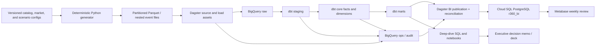
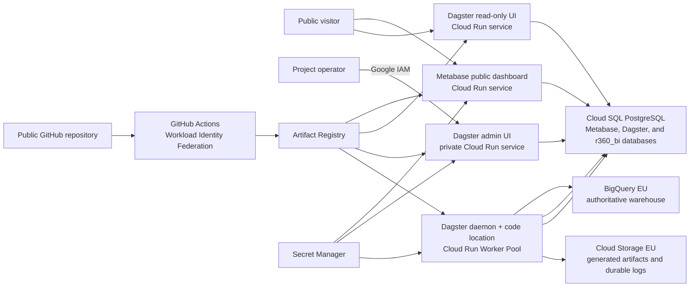

# Rider 360

## Product discovery, architecture, analytics, and delivery plan

**Status:** Implemented and verified end to end; TraceGate is the approved temporary GCP incubation host
**Prepared:** 2026-08-08
**Working company:** Riderly Bikes
**Data classification:** Entirely synthetic

> Rider 360 is an independently designed, portfolio-style ecommerce analytics platform for the fictional multinational company Riderly Bikes. Every company, feature, product, SKU, sizing rule, recommendation rule, claim, visual, and data record in the project will be original and synthetic.

This document incorporates the complete intent and scope of the attached initial plan. It also adds the decisions, contracts, controls, causal-analysis design, implementation gates, and delivery criteria needed to begin building without avoidable rework.

---

## 1. Executive summary

### Central business question

> **Should Riderly Bikes promote its SizePath more aggressively, and what are the biggest conversion, assortment, and customer-lifecycle opportunities in each market?**

### Fictional stakeholder request

The Global Ecommerce Director asks:

> Traffic and marketing spend are growing, but conversion is inconsistent across markets. We believe customers are struggling to choose the correct bike size, especially on mobile. At the same time, some popular products have high cart abandonment and elevated returns.
>
> Determine whether the SizePath improves conversion and reduces size-related returns. Identify the three highest-impact actions by market, device, channel, and product, and estimate their commercial impact.

### Recommended product shape

Build a reproducible analytical case study, not a shopping application:

1. A deterministic synthetic-data generator with known business and measurement failure modes.
2. GA4-shaped clickstream plus operational commerce, inventory, returns, marketing, product, and FX data.
3. BigQuery as the authoritative warehouse in the `EU` multi-region.
4. dbt Core for SQL transformations, contracts, documentation, data tests, and targeted SQL unit tests.
5. Dagster for source assets, partition-aware loading, orchestration, freshness, checks, and backfills.
6. A thin PostgreSQL BI serving layer containing only reconciled, dashboard-ready copies of approved BigQuery marts, with Metabase presenting one five-tab weekly review dashboard from that layer.
7. A defensible deep-dive analysis of the SizePath, funnel, products, acquisition quality, cohorts, and CLV.
8. A concise executive memo or five-to-seven-slide decision deck.
9. A small data-layer instrumentation demonstration only after the analytical core is reliable.

### Definition of project success

The project succeeds if another analyst can:

- generate the same data from a fixed seed;
- load and rebuild a small fixture or the full dataset without manual table editing;
- trace every dashboard KPI to a documented warehouse model and metric contract;
- observe deliberately planted data problems before trusting the business results;
- reproduce the main analysis and recover the known direction of the planted effects;
- distinguish descriptive association from causal evidence;
- understand the top three recommended actions, their estimated value, uncertainty, owner, and measurement plan;
- verify from the repository that every person, session, order, and finding is fictional.

### Recommended first implementation slice

Do not generate four million events first. Build a thin vertical slice with one market, 30 days, approximately 10,000 sessions, one bike family, one accessory family, and one planted checkout anomaly. Prove this path end to end:

```text
configuration
  -> deterministic generation
  -> partitioned raw files
  -> BigQuery raw load
  -> dbt event/session/order models
  -> one Dagster check
  -> one funnel mart
  -> one Metabase card
  -> one reconciliation query
```

Only then expand to the full history and all scenarios.

---

## 2. What the initial plan already gets right

The attached plan has the correct emphasis: business impact, analytical judgment, data reliability, and management communication. It intentionally covers the responsibilities below without turning the project into an ecommerce-site build.

| Capability | Planned evidence |
|---|---|
| Web analytics and funnel optimization | Session-level commerce funnel and transition diagnostics |
| User-path analysis | SizePath, product comparison, product page, and checkout journeys |
| Customer and cohort analysis | Repeat purchase, realized contribution CLV, retention, and next-bike progression |
| Product and assortment analytics | Demand, conversion, availability, attach rate, margin, and returns |
| Marketing analysis | CAC, ROAS, new-customer acquisition, and cohort quality |
| Data storytelling | Executive recommendation memo or decision deck |
| Warehouse contribution | Dimensions, facts, marts, contracts, tests, and metric definitions |
| Reliability and plausibility | dbt tests, Dagster asset checks, freshness, and source reconciliation |

The following initial constraints remain in force:

- 24-36 months of history;
- 5-6 fictional markets;
- roughly 250,000-500,000 sessions and 3-5 million events;
- roughly 15,000-30,000 orders;
- roughly 30-50 bike, helmet, accessory, and spare-part SKUs;
- daily marketing and inventory data;
- no real names, addresses, emails, IP addresses, payment details, or other real personal data;
- SQL-first transformations;
- Dagster supports reliability but is not the headline;
- no recommendation engine, polished storefront, or speculative churn model.

---

## 3. Important refinements to the baseline plan

These refinements should be treated as design corrections, not optional polish.

### 3.1 Model the SizePath as a branch, not a universal funnel step

The SizePath may occur before a product view, from a product page, or not at all. A single linear funnel such as `product view -> SizePath -> add to cart` creates false drop-offs. Use two related funnels:

```text
Core commerce funnel
eligible session -> view item -> add to cart -> begin checkout
                 -> add payment info -> purchase

SizePath sub-funnel
CTA impression -> start -> answers -> complete -> recommendation view
               -> recommendation click -> downstream product/cart/purchase events
```

Join the branches by `session_key`, `user_pseudo_id`, and a new `size_path_run_id`.

### 3.2 Separate observed SizePath use from experimental treatment

`size_path_completed = true` is a self-selected, post-entry behavior. It is not an experimental treatment, and comparing completers with non-users will be confounded by shopping intent and completion ability. The future experiment should randomize **SizePath CTA prominence or placement**, then analyze assignment using intent-to-treat. Completion is a mediator and a secondary metric.

The observational study may estimate a carefully qualified association or adjusted effect among eligible sessions, but it must not claim that completion itself was randomized.

### 3.3 Put a known causal truth inside the generator

The generator should create a latent purchase-intent variable and explicit SizePath effect parameters. Intent affects both SizePath use and purchase, while the SizePath has a smaller true effect on product fit, conversion, and size-related returns. The latent variables and expected effects belong in a validation-only truth artifact and must not appear in analytical marts. This lets us compare:

- naive observed difference;
- adjusted observational estimate;
- known synthetic truth;
- proposed randomized-test estimand.

### 3.4 Do not collect outcomes as event parameters

`recommendation_followed` is not known when the recommendation event fires. Remove it from the tracking payload and derive it later by linking recommendation, product, cart, and purchase events. The same rule applies to conversion, return outcome, customer type at a future purchase, and other future-looking labels.

### 3.5 Add the exposure events and identifiers required to answer the question

Add at minimum:

- `size_path_cta_impression` to measure prominence and true eligibility;
- `size_path_run_id` for multiple SizePath attempts in one session;
- `size_path_version` and `size_path_placement` for release/placement analysis;
- `recommendation_set_id` and `recommendation_rank` for multiple recommendations;
- `experiment_id` and `variant_id` when an experiment exists;
- `checkout_error` with a sanitized stage/code for diagnosing the French payment issue;
- `accessory_bundle_click` to complement bundle impressions.

### 3.6 Give operational systems authority over commerce facts

GA4 purchase and refund events are behavioral evidence, not the accounting ledger. Operational orders, order items, fulfillment, and returns are canonical for order count, revenue, COGS, refund, and margin. GA4 is reconciled to those facts and used for journey attribution.

### 3.7 Treat time, currency, identity, and return maturity as explicit contracts

Most analytical errors in this project will otherwise come from:

- a GA4 property date versus UTC versus market-local date;
- `ga_session_id` being treated as globally unique;
- gross, net, tax-inclusive, and return-adjusted revenue being mixed;
- recent orders appearing to have artificially low return rates;
- changing catalog prices being stored as one global product price;
- customer, anonymous visitor, and household/rider concepts being conflated.

The contracts in later sections resolve these by default and identify what remains a business choice.

### 3.8 Add an operations sidecar to the analytical layers

The Data Reliability dashboard cannot read Dagster's internal state magically. Dagster and dbt run/check outcomes must be written to queryable audit tables in an `ops` dataset. `mart_data_reliability` exposes the approved aggregate outcomes through the PostgreSQL BI publication step so Metabase never needs direct BigQuery credentials.

### 3.9 Prefer physical dbt marts and a transformation-free BI serving layer

The attached plan correctly keeps heavy logic out of Metabase. Current Metabase documentation also points users from models toward transforms, but neither is needed here: dbt should materialize the governed analytical entities in BigQuery. Dagster then publishes approved, dashboard-ready tables into PostgreSQL without changing their business meaning. Metabase can add metadata, simple governed metrics, questions, and visualization without becoming a second transformation layer.

### 3.10 Plan explicitly for dashboard reproducibility

Metabase's supported serialization workflow is a paid feature. If this project uses Metabase Open Source, the repository must retain dashboard SQL, metric definitions, a setup guide, and either a tested bootstrap script or a clearly documented manual build. Do not assume the local Metabase application database is a portable source-code format.

---

## 4. Decisions the product must support

The platform is not just a dashboard. Each output should map to a decision.

| Decision | Primary consumer | Evidence required | Cadence |
|---|---|---|---|
| Promote the SizePath, change it, or leave it alone | Global Ecommerce Director | adjusted observational evidence, return maturity, experiment plan | Quarterly/deep dive |
| Fix checkout before buying more traffic | Market lead and product owner | step conversion by market/device/release plus error evidence | Weekly/incident |
| Replenish, substitute, or stop promoting a product | Merchandising and inventory | demand, stockout exposure, margin, substitution, returns | Weekly |
| Change accessory placement or bundles | Merchandising | eligible bike orders, attach, margin, compatibility | Weekly/monthly |
| Shift channel budget | Growth lead | CAC, net ROAS, first-customer rate, realized 365-day contribution | Monthly |
| Trust or pause reporting | Analytics/data owner | freshness, completeness, duplicates, reconciliation, parameter coverage | Daily/weekly |

Every executive recommendation will use this template:

```text
Finding
Evidence
Business impact
Recommended action
Expected outcome
Confidence and limitations
Suggested owner
How success will be measured
```

---

## 5. Scope, non-goals, and deliverables

### In scope

- Synthetic source systems and coherent customer journeys.
- Nested and repeated GA4-shaped events.
- Multi-market, multi-currency business reporting.
- Raw, staging, core, mart, and operations/audit models.
- Incremental daily processing, late-arriving data, reruns, and backfills.
- Funnel, SizePath, assortment, returns, marketing, cohort, and realized-CLV analyses.
- Data contracts, metric contracts, tests, checks, and reconciliation.
- One management dashboard and one concise decision artifact.
- A minimal GTM/data-layer demonstration.
- Documentation sufficient for a reviewer to reproduce a small version.

### Explicit non-goals

- A polished shopping application.
- A production recommendation engine.
- A black-box ML churn or predictive-CLV model.
- Real user tracking or real personal data.
- Recreating the GA4 UI exactly.
- Real-time streaming infrastructure.
- Enterprise-grade multi-tenant BI security.
- Making Dagster, dbt, or Metabase the story instead of the business finding.

### Required deliverables

1. Repository README and quick start.
2. This plan plus a short architecture decision log.
3. Versioned generator configurations, catalog, markets, and scenario registry.
4. Small committed fixture or a fast command to generate it; full generated data stays out of Git.
5. BigQuery DDL/loading process and dbt project.
6. Dagster asset graph, schedules, sensors/checks, and backfill instructions.
7. Metabase dashboard build assets and screenshots.
8. Metric dictionary and event tracking specification.
9. Analysis notebooks/SQL with exported, reviewable results.
10. Executive recommendation memo or five-to-seven-slide deck.
11. Data quality runbook and known-limitations note.

---

## 6. Research findings that affect the design

### 6.1 The journey and SizePath feature are independently designed

Riderly uses generic ecommerce concepts: product discovery, comparison, guided selection, cart, checkout, purchase, delivery, and returns. Its SizePath feature asks for coarse rider-fit and intended-use inputs, then recommends from an entirely invented catalog.

The feature name, question flow, input bands, sizing overlaps, ranking logic, fallback behavior, copy, catalog, product attributes, imagery, and claims must be created for this project. No real children's-bike company, product page, sizing tool, URL, screenshot, catalog identifier, or source-derived recommendation rule belongs in code, data, documentation, fixtures, commit history, dashboard content, or public presentation.

### 6.2 The public GA4 sample is a schema reference, not the project dataset

Google's obfuscated ecommerce sample covers 2020-11-01 through 2021-01-31 and warns that obfuscation limits internal consistency. It is useful for testing field extraction from `event_params` and `items`; it cannot support the custom SizePath journey, returns, inventory, spend, or long-term customer lifecycle required here.

The public sample resides in BigQuery's `US` multi-region. BigQuery requires tables participating in a query to be colocated. Therefore:

- query the sample separately in `US` for learning/schema checks;
- create Riderly datasets in `EU`;
- never make the `US` sample a runtime dependency of the Riderly pipeline.

### 6.3 GA4 daily tables are mutable for late events

GA4 daily export tables can be updated for up to three days after the event date. The event pipeline should therefore rebuild at least the last four event-date partitions on each daily run rather than append only "yesterday."

### 6.4 GA4 and warehouse numbers should not be forced to match

GA4 reporting surfaces and raw BigQuery export differ in identity, modeling, attribution, timing, and calculation behavior. Google documents expected discrepancies. This project will document the reporting contract and reconcile explainable differences rather than alter raw data to imitate the UI.

### 6.5 BigQuery location, trial-credit use, and cost visibility are early decisions

Dataset location is fixed at creation, so the authoritative BigQuery datasets will use the `EU` multi-region. The available GCP trial credits may be used without an artificial workload ceiling or restrictive query quota. That does not remove engineering discipline: partition pruning, dry runs for large ad hoc queries, required partition filters where appropriate, job labels, materialized marts, and bytes-processed telemetry remain part of the design.

While Rider 360 is incubated inside a shared billed project, every supported resource and BigQuery job must carry the Rider cost labels defined in Section 6.10. A label-filtered alerts-only budget and billing-export queries will provide Rider-specific visibility; the shared host's project-level total remains a secondary cross-check because not every charge is guaranteed to carry a user label. The account must not be upgraded into paid post-trial spending, or left able to incur charges after trial credit expires, without fresh explicit approval.

### 6.6 Current dbt and Dagster capabilities support the plan

dbt supports BigQuery partitioning/clustering, `merge` and `insert_overwrite` incremental strategies, data tests, and SQL unit tests. Dagster's current dbt integration can represent dbt models as assets and dbt tests as asset checks; its BigQuery integration exposes `BigQueryResource`. We should use these integrations rather than build a custom SQL runner.

### 6.7 Synthetic does not mean privacy can be ignored in the design

This dataset is generated from distributions and rules, not synthesized from real customer rows, so it can be genuinely synthetic. In a real implementation, pseudonymous cookie/device IDs remain personal data when re-identification is possible. The tracking demo should therefore demonstrate minimization: coarse age/height bands, no child name or birth date, no free text, no precise location, and no secrets or identifiers in the repository.

### 6.8 Local environment and account readiness snapshot

Observed on 2026-08-08:

| Tool or account surface | Status |
|---|---|
| Git | Installed (`2.53.0.windows.2`); this folder is not yet a Git repository |
| GitHub CLI | Installed (`2.88.1`) and authenticated to the current personal account with `repo` and `workflow` access; public repository creation is approved |
| Python | `3.11.9`; Python launcher also has `3.14.0` |
| Docker | CLI installed (`29.6.1`); Docker Desktop daemon was not running during discovery |
| Google Cloud SDK / `bq` | Installed; the intended Google identity is active |
| Node.js / npm | Installed (`22.14.0` / `11.2.0`) |
| `uv` | Not installed; installation is explicitly approved |

Use Python 3.11 initially and install `uv`; commit `uv.lock`. Pin dbt, Dagster, Metabase, and container image versions only after a compatibility smoke test. Starting Docker Desktop and installing `uv` are implementation steps, not design questions.

### 6.9 Verified GCP state and approved interim path

The 2026-08-08 account and project audit established:

- the intended Google identity is active in both the CLI and Google Cloud Console;
- the open billing account is authoritatively labeled **Free Trial**, is active, and has remaining credit and trial time; the private balance and billing-account identifier will not be committed;
- six projects are visible to the identity, five of which are already linked to the Free Trial billing account;
- the selected sixth project is active, owned by the intended identity, and empty across the inspected resource surfaces, including BigQuery datasets, Cloud Storage buckets, Compute Engine instances/disks/images, and Pub/Sub topics;
- that project was successfully renamed **Rider 360**; its unrelated immutable project ID is acceptable and will be kept out of public documentation where it is not needed;
- a dedicated local `gcloud` configuration named `rider-360` now points to the intended identity and project but remains inactive, so the unrelated default project is not silently retargeted;
- a guarded attempt to link Rider 360 to the verified Free Trial account failed with `FAILED_PRECONDITION: Cloud billing quota exceeded`; immediate readback confirmed `billingEnabled=false`;
- the five currently billed projects all have running Compute Engine VMs and attached disks, with some also holding buckets, Cloud Run services, repositories, addresses, or secrets, so none is safe to disconnect automatically;
- an official request to increase the billing account's associated-project quota by one was successfully submitted on 2026-08-08. Google's confirmation says review typically takes about two business days;
- a follow-up read-only comparison identified **TraceGate** as the least risky billed incubation host: one running `e2-micro` VM, one attached 30 GB disk, one default VPC, no detected BigQuery datasets, Cloud Storage buckets, Cloud Run services, Cloud SQL instances, Artifact Registry repositories, secrets, or Pub/Sub topics, and no human project principal other than the owner;
- TraceGate's existing VM and its tagged firewall rules use the default VPC. Rider 360 will not attach anything to that network or modify those resources;
- on 2026-08-08, the owner explicitly approved TraceGate as Rider 360's temporary shared GCP host. This removes the billing-linkage gate for beginning cloud development, but it does not convert TraceGate into a dedicated security or quota boundary.

Before the first Rider 360 write in TraceGate:

1. Create a separate, initially inactive `gcloud` configuration named `rider-360-incubator`; do not repoint the existing `rider-360` configuration, which remains reserved for the dedicated project.
2. Read back the active identity, TraceGate project identity, `billingEnabled=true`, and a fresh inventory immediately before applying infrastructure.
3. Bootstrap the Rider-specific Terraform state and safety checks described below; do not import or manage any pre-existing TraceGate resource.
4. Apply Rider prefixes and labels to every supported resource from its creation time, then establish label-filtered cost alerts and telemetry.
5. Keep personal email addresses, full billing-account identifiers, immutable project identifiers, unrelated resource names, and private credit details out of the public repository.

### 6.10 Shared-project containment and migration contract

TraceGate is an incubation host, not a folder or subproject. IAM inherited from the project, project-level quotas, API enablement, billing, audit logs, and ownership remain shared. The residual risk is acceptable for a single-owner, synthetic-data portfolio environment only because the following controls are mandatory:

| Boundary | Required Rider 360 convention |
|---|---|
| Resource namespace | Use `r360-` for GCP resource names and `r360_` for BigQuery datasets; append a deterministic project-number or generated suffix where global uniqueness is required |
| Labels | Apply `application=rider-360`, `environment=<dev|demo|ci>`, `managed_by=terraform`, and `data_classification=synthetic`; add `component` where supported |
| Identity | Create dedicated deployer, Dagster, Metabase, and data-loader service accounts; never use the default Compute service account or an existing TraceGate service account |
| Data | Create dedicated `r360_<layer>_<environment>` BigQuery datasets, dedicated buckets, a dedicated Cloud SQL instance, and dedicated database users |
| Runtime | Use only `r360-*` Cloud Run services, jobs, worker pools, Artifact Registry repositories, secrets, alert policies, and dashboards |
| Network | Do not use or alter TraceGate's default VPC, routes, firewall rules, VM tags, or external address; prefer serverless connectivity initially and create an unpeered custom-mode `r360-vpc` only if the topology requires it |
| Terraform state | Use a Rider-only versioned state bucket/key and a separate state per host project/environment; never change the provider project inside an existing state to perform migration |
| Terraform authority | Do not manage the project, billing association, existing resources, or authoritative project IAM; use additive IAM members and ensure API resources are not disabled on destroy |
| Change safety | Reject any plan that mutates or destroys a pre-existing resource or any managed resource missing the expected Rider prefix/labels; capture before/after inventories |
| Cost and quota | Use resource/job labels, a label-filtered alerts-only budget, billing-export analysis, and preflight quota checks; accept that quotas and some unattributed costs remain project-shared |

When the dedicated Rider 360 project becomes billable, migration will be a parallel redeployment with a fresh Terraform state: provision the dedicated environment, regenerate/reload the synthetic warehouse, transfer only necessary application state, verify public endpoints and data reconciliation, and only then destroy the incubator resources from the Rider-only state. Existing TraceGate resources remain out of scope throughout.

### 6.11 Public-demo hosting constraints

Metabase public links are view-only, but dashboard filters are not a security boundary. Only synthetic, aggregate marts may be exposed; row-level pseudonymous users and operational tables remain unavailable to the public Metabase role.

Dagster Open Source does not provide the authentication/RBAC boundary needed for an anonymous write-capable UI. The public Dagster endpoint must run in read-only mode. A separate operator endpoint will require Google Cloud IAM authentication.

Cloud Run services fit the HTTP UIs, while a Cloud Run Worker Pool fits the continuously running Dagster daemon because worker pools have no public URL and are intended for continuous background work. One Rider-only Cloud SQL for PostgreSQL instance will hold three isolated databases: Metabase application state, Dagster shared state, and the `r360_bi` serving database. Separate IAM database users and automatic Cloud SQL IAM database authentication must be used for hosted services so no Google service-account JSON key or long-lived PostgreSQL password is required. A short Phase 0 deployment spike must validate the selected Dagster run launcher, code-location sidecar, passwordless Cloud SQL connectivity, public read-only mode, and worker-pool availability in the selected project/region before the topology is treated as final.

---

## 7. Proposed architecture



### Component responsibilities

| Component | Owns | Must not own |
|---|---|---|
| Generator | coherent synthetic behavior, source schemas, anomalies, hidden truth | business KPI SQL |
| BigQuery raw | source-faithful representation and ingestion metadata | silent business corrections |
| dbt staging | types, names, flattening, dedupe flags, source normalization | business presentation |
| dbt core | canonical grains, keys, identity, currency/time logic, reusable facts/dimensions | dashboard-specific labels |
| dbt marts | decision-ready entities, additive components, governed KPI inputs | raw nested parsing |
| Dagster | dependencies, partitions, retries, schedules, sensors, checks, audit emission, atomic BI publication and reconciliation | duplicate transformation logic |
| PostgreSQL BI serving layer | read-optimized, dashboard-ready copies of approved BigQuery marts plus publication metadata | authoritative KPI logic, raw data, or unapproved row-level entities |
| Metabase | exploration metadata, simple governed metrics, visualization, dashboard filters | heavy joins and competing KPI definitions |
| Analysis layer | causal caveats, diagnostics, scenarios, opportunity sizing | changing source-of-truth facts |

### Public demo deployment topology



Deployment defaults:

- Treat the GCP project as an explicit deployment variable. TraceGate is the approved `incubator` host; the unbilled Rider 360 project remains the intended dedicated destination when billing association becomes available.
- Use the namespace and labels from Section 6.10 everywhere. No Rider resource may reuse an existing TraceGate name, service account, bucket, Terraform state, VPC, subnet, route, firewall rule, secret, or runtime.
- BigQuery and Cloud Storage use `EU`; Cloud Run and Cloud SQL use `europe-west1` unless the Phase 0 compatibility/availability check finds a concrete reason to change.
- Metabase and the public read-only Dagster UI are anonymous Cloud Run services with managed HTTPS URLs. No custom domain is required for the first release.
- The Dagster admin service is private and protected by Cloud Run IAM. Anonymous visitors must be unable to launch runs, change schedules/sensors, terminate work, or mutate state.
- The Dagster Worker Pool has one instance and no inbound public endpoint. Its daemon uses a queued run coordinator and a colocated code-location sidecar; the Phase 0 spike validates the exact run launcher.
- BigQuery remains authoritative. Dagster publishes only an allowlisted set of validated presentation marts and approved aggregate reliability views into the `r360_bi` PostgreSQL database; Metabase never queries BigQuery directly.
- One Cloud SQL PostgreSQL instance holds separate `metabase`, `dagster`, and `r360_bi` databases with distinct least-privilege IAM database users. Hosted connections use automatic IAM database authentication through a Cloud SQL connector/proxy; no service-account JSON key or long-lived database password is permitted.
- Artifact Registry stores pinned images; Secret Manager stores application secrets; GitHub Actions deploys through Workload Identity Federation without long-lived service-account keys.
- Terraform owns Rider-specific durable cloud resources from the foundation onward. It must never own the shared host project or unrelated resources. Emergency/manual changes to Rider resources must be imported or reconciled immediately.
- Minimum instances for public UIs may be set to one during active portfolio demonstrations for predictable startup, then lowered when responsiveness is less important.

### Environments

Use four logical targets even if only local development exists at first:

| Target | Purpose | Data volume | Isolation |
|---|---|---:|---|
| `local` | Generator/unit development and local Docker dashboard | tiny fixture | local files plus optional DuckDB inspection only |
| `ci` | deterministic tests and dbt build | 5k-10k sessions | isolated BigQuery dataset per protected CI run when credentials are available |
| `dev` | engineering integration and backfill testing | configurable subset/full | persistent `r360_*_dev` resources in the approved host project |
| `demo` | public portfolio dashboard and orchestration status | full fixed release dataset | dedicated `r360_*_demo` resources, read-only BI identity, aggregate-only public surfaces |

Use dataset prefixes/suffixes rather than additional GCP projects for these logical environments. BigQuery SQL is authoritative. A local DuckDB profile may speed generator inspection, but supporting two fully equivalent SQL dialects is not a goal.

### Authentication and secrets

- Use Application Default Credentials for local Python/dbt/Dagster work and target-specific named `gcloud` configurations: `rider-360-incubator` for TraceGate and `rider-360` for the future dedicated project. Scripts must require an explicit configuration/project and verify it before writes.
- Use Workload Identity Federation for GitHub Actions; do not create a deploy key JSON file.
- Use separate Cloud Run service accounts for Metabase, Dagster orchestration/publication, and deployment.
- Give Metabase no BigQuery IAM permissions. Its hosted identity receives read-only PostgreSQL privileges on `r360_bi` and the required read/write privileges only on its own application database.
- Give Dagster's hosted identity only the BigQuery, GCS, and PostgreSQL publication privileges required by its assets; use automatic Cloud SQL IAM database authentication for both Dagster and Metabase.
- Allow unauthenticated invocation only for the Metabase public presentation surface and the read-only Dagster service.
- Require Cloud Run IAM authentication for the Dagster admin service.
- Store application encryption keys, bootstrap/admin credentials, and any unavoidable runtime secrets in Secret Manager. Do not create a hosted Google service-account key or static Cloud SQL database password.
- Commit `.env.example`, never `.env`, credentials, billing identifiers, or secrets.
- Do not expose cloud credentials to pull requests from forks of the public repository.

---

## 8. Synthetic data product

### Recommended default scale

| Setting | Full default | Fast fixture |
|---|---:|---:|
| Fixed history | 2023-01-01 through 2025-12-31 | 30 days |
| Markets | AT, DE, FR, NL, GB, US | DE only |
| Sessions | about 450,000 | about 10,000 |
| Events | about 4,000,000 | about 80,000-120,000 |
| Orders | about 20,000-25,000 | calibrated from the same model |
| SKUs | about 40 | small subset |
| Seeds | master seed plus stable per-entity/per-date sub-seeds | same mechanism |

A fixed historic window is preferred over "the last 36 months" because builds and screenshots remain reproducible. The final 60+ days should be excluded from mature-return metrics while remaining present for current-period funnel reporting.

### Recommended market defaults

| Market | Transaction currency | Reporting timezone | Example language |
|---|---|---|---|
| Austria | EUR | `Europe/Vienna` | `de-AT` |
| Germany | EUR | `Europe/Berlin` | `de-DE` |
| France | EUR | `Europe/Paris` | `fr-FR` |
| Netherlands | EUR | `Europe/Amsterdam` | `nl-NL` |
| United Kingdom | GBP | `Europe/London` | `en-GB` |
| United States | USD | `America/New_York` as the site's reporting timezone | `en-US` |

The US reporting timezone is an analytical convention for the fictional site, not a claim that all US customers share one timezone.

### Generation principles

1. **Coherence before volume.** Purchases in clickstream must map to operational orders; order items must exist in the catalog; returns must reference delivered items; spend campaigns must match attributable sessions.
2. **Determinism.** A configuration hash, generator version, and master seed must reproduce identical identifiers, counts, and amounts.
3. **Stable partition generation.** Rebuilding one date must not change unrelated dates. Derive sub-seeds from the master seed and stable partition/entity keys.
4. **Seasonality.** Include weekday, month/holiday, market, campaign, device, product, and launch effects.
5. **Correlated behavior.** Intent, device, channel, visitor history, availability, price, and product fit should affect multiple steps rather than each KPI being sampled independently.
6. **Lifecycle realism.** Distinguish near-term accessory purchases from longer next-bike purchases; use latent rider/household state internally without exporting child identities.
7. **Known truth.** Write a validation manifest containing configured causal effects and scenario windows. Do not expose latent intent or true counterfactual outcomes to warehouse marts.
8. **Data minimization.** Generate only fields used by a contract, scenario, check, or analysis.
9. **No full data in Git.** Commit schemas/configs and a very small fixture only; ignore bulk generated output.

### Generator implementation default

- Use NumPy's explicit random `Generator` instances with derived stable seeds; never depend on module-global random state.
- Use Polars lazy/batched operations for high-volume relational generation and PyArrow-compatible Parquet output.
- Generate by stable date/market/entity chunks so the full four-million-event build does not require all rows in memory.
- Derive identifiers from namespaced hashes of stable inputs rather than `uuid4`, making partition rebuilds reproducible.
- Define nested GA4 event/item schemas explicitly before writing; do not rely on inference from the first batch.
- Use lightweight typed configuration/schema validation; Faker is unnecessary because no human PII should be generated.

### Suggested generation order

```text
markets and calendar
-> catalog, compatibility, and time-varying market prices
-> anonymous visitors, latent households/riders, and customers
-> marketing campaigns and daily spend
-> inventory/availability paths
-> sessions and pre-treatment intent/context
-> journey events and SizePath runs
-> purchases, orders, items, fulfillment, and payment outcome
-> returns and costs
-> deliberately corrupted measurement/delivery copies
-> manifests, row counts, checksums, and validation truth
```

### Source contracts

The initial source list is retained and refined below.

| Source | Grain | Required identifiers and important fields | Authority |
|---|---|---|---|
| `ga4_events_*` | one event with repeated params/items | event timestamp/date/name, pseudo user, stream, session params, market, device, acquisition fields, items, privacy info | behavior |
| `orders` | one order | order ID, customer ID, placed/paid/cancelled timestamps, status, market, currency, item totals, discount, tax, shipping charged | commerce |
| `order_items` | one order line | order item ID, order ID, SKU, quantity, unit list price, discount, tax allocation, COGS, fulfilled/delivered timestamps | commerce |
| `returns` | one returned quantity event | return ID, order item ID, requested/received/refunded timestamps, quantity, reason, refund, processing cost | returns |
| `products` | one catalog product version | SKU, family, category, model, wheel size, age/height bands, valid dates, status | catalog |
| `product_market_prices` | one SKU-market-validity interval | SKU, market, currency, list price, promotional price, valid from/to | catalog/pricing |
| `product_accessory_compatibility` | one bike-accessory pair | parent SKU, accessory SKU, compatibility type, valid from/to | catalog |
| `inventory_daily` | one market-SKU-date | beginning/end available-to-sell quantity, receipts, units reserved/sold, stockout minutes/status | inventory |
| `marketing_spend` | one market-campaign-channel-date | impressions, clicks, cost, currency, source, medium, campaign ID | marketing platform |
| `exchange_rates` | one currency pair-rate date | source currency, reporting currency, rate, provider date, loaded timestamp | finance/FX |
| `customers` | one known purchaser | pseudonymous customer ID, first order date, acquisition market | commerce identity |
| `source_delivery_log` | one source partition delivery | source, partition, expected/received/loaded timestamps, row count, checksum | ingestion control |

The time-varying price and compatibility tables are additions. A single product-level price is insufficient for multiple currencies, markets, promotions, and three years of history.

### Money contract

- Source money is stored in the transaction currency using exact decimal values, never binary floating point.
- Generator calculations use integer minor units where practical; BigQuery uses `NUMERIC`.
- Reporting currency default is EUR.
- Convert using the transaction/order date and retain both local-currency and reporting-currency amounts plus the applied rate/date.
- Do not silently fill missing FX. Use a bounded forward-fill policy only after flagging the source gap; record `fx_rate_is_imputed` and source date.
- Tax is excluded from net merchandise revenue and contribution margin by default.
- Shipping charged and fulfillment/shipping cost are separate fields.
- Marketing spend is not deducted from contribution margin; it is compared through CAC/ROAS and may be included in a separately named post-marketing contribution metric.

### Time contract

- Store source and canonical timestamps in UTC.
- Preserve GA4 `event_date`, which follows the GA4 property timezone.
- Derive `market_date` using the configured IANA reporting timezone for each market.
- Partition raw GA4-shaped data by its source `event_date`; partition core events by canonical event date as explicitly documented.
- Use half-open validity intervals (`valid_from <= timestamp < valid_to`).
- Test daylight-saving boundaries for European and US timezones.
- Keep `event_at`, `source_updated_at`, `arrived_at`, and `loaded_at` distinct so event time is never confused with processing time.

### Identity contract

| Concept | Key | Meaning |
|---|---|---|
| Anonymous browser/app instance | `user_pseudo_id` | GA4-like device/browser identity; not a person |
| Known account/purchaser | `customer_id` | synthetic operational identity when known |
| Session | `session_key` | hash of `stream_id`, `user_pseudo_id`, and `ga_session_id` |
| SizePath attempt | `size_path_run_id` | one SizePath run, potentially several per session |
| Transaction | `transaction_id` / `order_id` | shared business key used for reconciliation |
| Order line | `order_item_id` | stable operational line key |

`ga_session_id` must never be treated as globally unique. Cross-device identity is available only when a synthetic known customer link exists; otherwise identities stay separate. "New visitor" and "first-time purchaser" are different attributes and must not share a label.

---

## 9. Event tracking design

### Recommended GA4 property topology

Use one fictional global GA4 property and one web stream for the first release, with localized storefront paths/hosts represented by `site_market`. Set the synthetic property timezone to `Europe/Vienna` and its reporting currency to EUR. This gives `event_date` one honest property-timezone meaning while the warehouse separately derives market-local business dates. Retain `property_id` and `stream_id` in raw/core keys so a later multi-stream or per-market-property design would not require key redesign.

### Standard ecommerce events

Use GA4 recommended events and parameters where they exist:

```text
view_item_list
select_item
view_item
add_to_cart
remove_from_cart
view_cart
begin_checkout
add_shipping_info
add_payment_info
purchase
refund
```

The `purchase` and `refund` events must carry `transaction_id`, `currency`, `value`, and item data appropriate to the event. Operational commerce remains canonical.

### Custom journey events

```text
size_path_cta_impression
size_path_start
size_path_answer
size_path_complete
size_path_recommendation_view
size_path_recommendation_click
size_path_error
size_guide_open
product_compare
stock_unavailable
accessory_bundle_view
accessory_bundle_click
dealer_locator_open
checkout_error
```

Exits and abandonment should usually be derived from the absence of a later event within a defined window; do not rely on fragile `*_exit` events.

### Parameter registry

| Parameter | Scope | Notes |
|---|---|---|
| `event_id` | event | synthetic stable ID for pipeline testing; optional fallback in real GA4 |
| `ga_session_id` | event/session | integer extracted from `event_params`; combine with pseudo user and stream |
| `site_market` | event | explicit storefront market; do not infer it only from geo-IP |
| `content_language` | event | language/locale shown |
| `size_path_run_id` | SizePath events | required across one SizePath attempt |
| `size_path_step` | answer/error | stable enum, not display copy |
| `size_path_version` | SizePath events | release/rule version |
| `size_path_placement` | CTA/start | listing page, product page, navigation, campaign landing, etc. |
| `child_age_band` | answer/complete | coarse synthetic band; never date of birth |
| `child_height_band` | answer/complete | coarse band; exact height is unnecessary for analytics |
| `riding_skill` | answer/complete | controlled enum |
| `terrain_preference` | answer/complete | optional, controlled enum if used by fictional rules |
| `recommendation_set_id` | recommendation events | links a set of one or more results |
| `recommended_product_id` | recommendation event/item | invented Riderly SKU |
| `recommended_wheel_size` | recommendation event/item | controlled enum |
| `recommendation_rank` | recommendation item | supports multiple suggestions |
| `selected_product_id` | click | clicked recommendation; derive adherence later |
| `bundle_id` | bundle events | versioned bundle identifier |
| `error_stage` / `error_code` | error events | sanitized controlled enums, no gateway text or secrets |
| `experiment_id` / `variant_id` | exposure and downstream events | present only for actual synthetic experiment data |

### Tracking rules

- Keep event names and parameters within GA4 collection limits; use standard fields before consuming custom definitions.
- Use controlled, low-cardinality values. Do not send full URLs with user input, free text, exception traces, or payment/provider secrets.
- Register only custom dimensions needed in GA4 reporting; raw BigQuery can still retain sent parameters.
- Put product arrays in `items`, not duplicated product-ID parameters, when an event is item-oriented.
- Include the same assignment on relevant downstream events or join it from a durable assignment table.
- Validate all demo payloads with a schema/contract test.
- Initialize `window.dataLayer` once and use `dataLayer.push`; never overwrite it after GTM loads.
- Do not send `recommendation_followed`; derive it in the warehouse.

### GA4-shaped raw representation

At minimum, the generator should reproduce the fields used by the project:

- `event_date` and microsecond UTC `event_timestamp`;
- `event_name`, `event_bundle_sequence_id`, and source offset/arrival metadata;
- `user_pseudo_id`, optional `user_id`, and first-touch timestamp;
- repeated `event_params` with typed value fields;
- repeated ecommerce `items` and selected item-level custom params;
- device category, browser/platform, geo market surrogate, stream ID, and platform;
- `traffic_source`, collected traffic source, and session last-click fields where appropriate;
- consent/privacy fields sufficient to create eligible versus cookieless/test sessions.

The generator does not need to reproduce every column Google has ever exported.

---

## 10. Planted scenarios

### Business scenarios

| ID | Scenario | Synthetic mechanism | Expected analytical signal | Recommended validation |
|---|---|---|---|---|
| B1 | French mobile payment regression | release-date effect on mobile payment success in FR only | stable earlier steps; sharp `add_payment_info -> purchase` drop; checkout errors rise | pre/post plus unaffected devices/markets as controls |
| B2 | Popular 16-inch bike stockout in AT/DE | constrained inventory for a high-demand SKU | views remain high; add-to-cart falls; substitutes/dealer locator/exit rise | join view sessions to market-date availability |
| B3 | SizePath has real but confounded value | intent raises use and conversion; SizePath independently improves fit and modestly improves conversion | naive lift exceeds configured causal effect; adjusted estimate moves toward truth; size returns improve | balance diagnostics, overlap, adjusted model, hidden-truth comparison |
| B4 | Poor accessory merchandising | low bundle exposure/click for selected bike pages despite compatibility and margin | below-benchmark attach conditional on eligible bike order | compatibility-aware attach and opportunity estimate |
| B5 | Misleading last-click performance | paid social has weak immediate ROAS but better customer mix; affiliates are coupon-heavy and low repeat | channel ranking changes using 365-day contribution | first-order cohorts and mature contribution windows |

### Measurement/data-quality scenarios

| ID | Scenario | Injection | Expected control |
|---|---|---|---|
| Q1 | Duplicate purchases | client and server purchase events share a transaction ID | flag/dedupe GA4 purchase fact; operational order remains one |
| Q2 | Timezone mismatch | GA4 source date follows property timezone; commerce stores UTC | canonical UTC plus explicit market dates; boundary tests |
| Q3 | Missing FX | omit several source-currency dates | failing completeness check; bounded, flagged imputation only after policy |
| Q4 | Payment referral pollution | gateway referral overwrites collected source | normalization seed plus preserved raw source and last-non-direct rule |
| Q5 | Late returns | return source partitions arrive days/weeks after orders | updated-at merge and long lookback; cohort maturity |
| Q6 | SizePath parameter coverage regression | release lowers `recommended_product_id` population | coverage check segmented by version/date; severity threshold |

### Scenario configuration contract

Each scenario in `config/scenarios.yml` should declare:

```yaml
id: B1
enabled: true
start_date: 2025-03-10
end_date: null
affected_dimensions:
  market: [FR]
  device_category: [mobile]
mechanism:
  payment_success_multiplier: 0.70
expected_direction:
  payment_to_purchase_rate: down
validation_tolerance: configurable
```

Exact dates and effect sizes are proposals until the scenario-calibration decision is approved. Configuration is allowed to reveal the synthetic truth for reproducibility; a separate "blind analyst" seed/config can be supplied if discovering the issue without spoilers is part of the demonstration.

---

## 11. Warehouse model

### Datasets and logical layers

```text
r360_raw_<env>       source-faithful tables and ingestion metadata; mutable deliveries are versioned/audited
r360_staging_<env>   typed, renamed, flattened, lightly normalized source models
r360_core_<env>      conformed facts, dimensions, keys, attribution, money, and time
r360_marts_<env>     decision-ready tables exposed to BI and analysis
r360_ops_<env>       pipeline runs, asset checks, source freshness, reconciliation history
```

The initial three-layer idea remains conceptually valid; the explicit `staging` dataset prevents raw parsing from leaking into core, while `ops` is a control plane rather than an analytical layer.

### Core model proposal

```text
dim_date
dim_market
dim_channel
dim_campaign
dim_product                 -- type-2/versioned where descriptive changes matter
dim_customer
bridge_product_accessory_compatibility

fct_events                  -- one canonical event
fct_event_items             -- one item per event item index
fct_sessions                -- one session
fct_size_path_runs             -- one SizePath attempt
fct_orders                  -- one operational order
fct_order_items             -- one operational order line
fct_returns                 -- one return quantity event
fct_inventory_daily         -- one market/SKU/date
fct_marketing_spend         -- one market/campaign/date
fct_exchange_rates          -- one pair/date with quality/imputation flags
```

### Mart proposal

```text
mart_daily_ecommerce
mart_session_funnel
mart_size_path_funnel
mart_size_path_impact
mart_product_assortment
mart_customer_cohorts
mart_marketing_efficiency
mart_data_reliability
```

`mart_size_path_funnel` is an addition that prevents the session funnel from pretending all journeys are linear. `mart_size_path_impact` contains analysis-ready pre-treatment covariates and outcomes, not a precomputed causal conclusion.

### Critical grain contracts

| Model | Grain/key | Important rule |
|---|---|---|
| `fct_events` | one `event_key` | retain raw duplicate flags; do not drop unexplained events silently |
| `fct_event_items` | `event_key`, `item_index` | preserve quantity, price, currency, SKU and item params |
| `fct_sessions` | one `session_key` | booleans/timestamps for each milestone plus eligibility and channel |
| `fct_size_path_runs` | one `size_path_run_id` | start/complete/recommendation state, placement/version, no future outcome labels unless clearly derived |
| `fct_orders` | one `order_id` | operational authority; one status/economic record after modeled updates |
| `fct_order_items` | one `order_item_id` | immutable transaction economics plus fulfillment state |
| `fct_returns` | one `return_id`/return line | multiple partial returns can reference one order item |
| `mart_session_funnel` | one eligible session | milestone timestamps and mutually understandable transition denominators |
| `mart_product_assortment` | product-market-period | store additive numerators/denominators, not only rates |

### Sessionization

Recommended session key:

```text
SHA256(stream_id || '|' || user_pseudo_id || '|' || ga_session_id)
```

Rules:

- Extract `ga_session_id` once in staging.
- Keep events with missing session data in `fct_events`, but exclude them from session-funnel denominators with an explicit reason.
- Use event timestamps, not row order, for milestones.
- A purchase belongs to a session when its canonical behavioral purchase event and transaction ID link to that session; otherwise keep the order as unattributed rather than inventing a link.
- A purchasing session is counted once even if it contains multiple purchase events or orders; order count remains separate.

### Purchase deduplication and reconciliation

1. Keep all raw purchase events.
2. Identify duplicates using `transaction_id` and source/client-server indicators.
3. Select one canonical behavioral purchase event using a documented precedence and earliest valid timestamp.
4. Count operational orders from `orders`, never from raw GA4 event rows.
5. Reconcile by date/market/currency and classify differences:
   - duplicate behavioral event;
   - missing behavioral event;
   - missing operational order;
   - timestamp/date boundary;
   - currency/value mismatch;
   - cancellation/refund timing;
   - expected unattributed/cookieless behavior.

### Attribution contract

Preserve multiple answers rather than hiding the model:

- **Raw collected source/medium/campaign** for debugging.
- **Normalized session channel** using session last-click data where present, with a documented fallback and payment-referral exclusion list.
- **First acquisition channel** from the customer's first eligible observed acquisition/session.
- **Order session channel** for same-session ROAS.
- **Customer acquisition channel** for CAC and cohort CLV.

Marketing spend joins on stable campaign ID, market, and spend date. Unmatched spend and unmatched attributed clicks are quality metrics, not dropped rows. The first release should use a documented last-non-direct/session model and first-touch customer acquisition; multi-touch attribution is out of scope.

### Incremental and late-arriving processing

"Raw" means uncorrected and source-faithful, not necessarily append-only. A GA4 daily partition is a replaceable source snapshot while Google can still update it: atomically replace the affected raw partition with the newest complete delivery and record the prior/new checksum, delivery version, row count, and load time in `ops`. For generated local files, retain manifests/versioned partition artifacts long enough to reproduce the load. Business corrections such as deduplication, referral repair, FX handling, and exclusions begin in staging/core and never alter the meaning of raw fields.

| Data | Default strategy | Lookback/rebuild |
|---|---|---|
| GA4-shaped events | partition `insert_overwrite` | current date plus previous 3 event dates |
| Orders/items | `merge` on stable key and `source_updated_at` | changes since prior watermark plus safety overlap |
| Returns | `merge` on return key | changes since watermark; allow long post-order arrival |
| Inventory/spend/FX | partition overwrite | recently delivered/corrected dates |
| Session/funnel marts | overwrite affected event-date partitions | include sessions crossing midnight and late-event window |
| Cohort/CLV marts | rebuild impacted cohorts or bounded full refresh | affected order/return/customer windows |

Every load must be idempotent. Backfill code uses the same transformations and contracts as the daily schedule.

### BigQuery physical design

- Partition high-volume event, session, order, item, return, inventory, spend, and daily marts on the date most commonly filtered and documented for that model.
- Cluster events/sessions by `site_market`, `device_category`, and normalized channel where useful.
- Cluster order items by `customer_id`, `product_id`, and/or `order_id` based on measured query patterns.
- Use `require_partition_filter` on large raw/core streams, but not blindly on small BI marts where it would break legitimate dashboard queries.
- Prefer static recent partitions with dbt `insert_overwrite` when it materially reduces BigQuery scans.
- Inspect query plans/dry runs before optimizing; do not add clustering everywhere by habit.

---

## 12. Metric contracts

Every metric definition must declare grain, numerator, denominator, exclusions, time basis, currency basis, maturity rule, and owner. Marts should expose additive components so totals recalculate correctly when filters change; never average precomputed percentages.

### Recommended definitions

| Metric | Proposed canonical definition | Key caveat |
|---|---|---|
| Eligible ecommerce sessions | distinct sessions with a valid session key and storefront activity, excluding bot/test/internal/invalid-consent rows according to policy | denominator policy must be visible |
| Session conversion rate | eligible sessions linked to at least one valid completed operational order / eligible ecommerce sessions | one purchasing session counts once |
| Gross item sales | sum of list unit price × purchased quantity before discounts/tax/returns | not revenue after returns |
| Net merchandise revenue | gross item sales - item discounts - refunded/returned item amount, excluding tax | name must state return maturity when applicable |
| Contribution margin | net merchandise revenue + shipping charged - COGS - fulfillment/shipping subsidy - payment cost - return processing cost | marketing excluded by default |
| Orders | distinct paid/completed operational orders, excluding test and fully cancelled orders | state exact accepted statuses |
| AOV | net order revenue / distinct valid orders | provide booked and return-adjusted variants if both are used |
| CAC | attributed spend / first-time purchasers attributed to that scope | distinguish customer acquisition from session conversion |
| Same-session ROAS | order-session attributed net revenue / attributable spend | not a customer-lifetime measure |
| Contribution CLV 90/365/730 | cumulative realized contribution per acquired customer within fixed days of first order | descriptive realized value, not predictive CLV |
| SizePath CTA start rate | sessions with SizePath start / eligible sessions with CTA impression | promotion question needs the impression denominator |
| SizePath completion rate | distinct completed runs / distinct started runs | also report session/user versions if needed |
| SizePath recommendation CTR | runs with recommendation click / completed runs with recommendation view | use `size_path_run_id` |
| Recommendation adherence | SizePath-assisted purchased bike lines matching the recommended product/allowed-size set / SizePath-assisted purchased bike lines | derive; define attribution window and ties |
| Accessory attach rate | eligible bike orders with at least one compatible accessory / eligible bike orders | "compatible" and accessory categories are versioned |
| Mature unit return rate | returned units / delivered units old enough to complete the return observation window | default proposed window: 60 days |
| Size-related mature return rate | mature returned units with controlled size/fit reason / mature delivered bike units | return reasons need normalization |
| Stockout exposure | product-view sessions where the viewed market/SKU was unavailable / product-view sessions | use event-time status when available; daily snapshot is an approximation |
| Funnel transition rate | sessions reaching step B after reaching step A / sessions reaching step A | do not use all sessions for every step |

### Metric policies to approve

- **Reporting currency:** EUR.
- **Return maturity:** 60 days after delivery, configurable and shown in metric names/descriptions.
- **Order status:** paid/fulfilled/completed are valid; tests, fraud, and fully cancelled orders are excluded; partial cancellations remain line-aware.
- **Revenue timing:** booked metrics use order date; return-adjusted reporting must state whether returns are restated to order date or recognized on return date. Recommended: maintain both, use order-cohort restatement for CLV and return analysis, accounting-date view for weekly operations.
- **Customer cohort date:** first valid order date in market-local reporting date, with a UTC timestamp retained.
- **FX:** transaction-date rate for cohort economics; flag bounded imputation.
- **CLV:** realized contribution only for the initial portfolio release.

---

## 13. Data quality and observability

### Responsibility split

| Control type | Primary home | Examples |
|---|---|---|
| Source contract/freshness | dbt sources plus Dagster | expected partition, schema, freshness |
| Row/model invariants | dbt data tests | uniqueness, not null, accepted values, relationships |
| SQL edge-case logic | dbt unit tests | session key, attribution, FX fill, return maturity, dedupe |
| Cross-system/business plausibility | Dagster asset checks or audit models | reconciliation, volume change, rate bounds |
| Generator correctness | pytest/property/invariant tests | determinism, referential integrity, configured effect direction |
| Dashboard trust state | `ops` tables and reliability mart | latest run/check/freshness outcomes |

### Required checks

```text
purchase_transaction_id_is_unique_after_dedupe
order_item_has_valid_order
return_has_valid_delivered_order_item
returned_quantity_does_not_exceed_delivered_quantity
all_required_currencies_have_exchange_rates
raw_ga4_partition_is_fresh
required_size_path_parameters_meet_coverage_threshold_by_version
warehouse_orders_reconcile_to_commerce_source
ga4_purchase_events_reconcile_to_orders_with_classified_differences
no_unexplained_future_event_timestamps
conversion_and_transition_rates_are_between_zero_and_one
daily_event_volume_is_within_a seasonality-aware range
session_key_is_unique
money_components_reconcile_within_rounding_tolerance
inventory_balance_is_plausible
marketing_spend_has_stable_campaign_keys
```

### Severity policy

- **Error/block downstream:** missing required partition, schema break, invalid key relationships above tolerance, missing FX without approved handling, duplicate canonical orders, money reconciliation beyond tolerance.
- **Warn but publish with visible degraded status:** unusual volume, low optional parameter coverage, modest GA4/order gap with classified reason, late noncritical source.
- **Informational:** expected synthetic scenario activation and known GA4/UI differences.

Thresholds belong in versioned configuration and should be segmented. A global 95% SizePath-parameter check can hide a total failure in one release or market.

### Audit tables

The `ops` dataset should include at least:

```text
pipeline_run_history
asset_materialization_history
asset_check_history
source_partition_history
reconciliation_history
data_quality_incidents
generator_manifest_history
```

Each record should carry run ID, asset/model, partition, status, observed value, threshold, timestamp, code/config version, and a human-readable message. Avoid creating a second full observability product; only persist what the reliability dashboard and runbook need.

---

## 14. Main analytical investigations

The order of operations is deliberate: establish trust first, then answer the business question.

### 14.1 Data trust and reconciliation

Before any business conclusion:

1. confirm source completeness and freshness;
2. inspect duplicate purchase events;
3. reconcile operational order counts and values;
4. quantify unattributed and missing-session orders;
5. assess SizePath parameter coverage by date/version/market/device;
6. resolve or explicitly bound FX and late-return effects;
7. publish a trust status and known limitations.

### 14.2 Locate the funnel problem

`mart_session_funnel` should include one row per eligible session with milestone timestamps/flags and dimensions:

```text
session_key
session_start_at
market_date
site_market
device_category
normalized_channel
visitor_status
landing_page_type
size_path_cta_seen
size_path_started
size_path_completed
recommendation_clicked
product_viewed
added_to_cart
checkout_started
shipping_added
payment_added
purchased
first_order_id
```

Analysis sequence:

1. Compare transition rates, not just overall conversion.
2. Segment by market/device/channel/release without searching thousands of cuts indiscriminately.
3. Plot pre-release stability and post-release change.
4. Compare France mobile with France desktop and similar mobile markets; use a simple difference-in-differences or controlled segmented regression as supporting evidence.
5. Inspect `checkout_error`, payment method, and source reconciliation to distinguish a real payment failure from missing tracking.
6. Quantify lost orders using a conservative counterfactual baseline and contribution margin, with a range rather than false precision.

### 14.3 Estimate SizePath impact carefully

#### Descriptive questions

- Who sees, starts, completes, and clicks the SizePath?
- Where does the SizePath lose users by step, placement, version, device, and market?
- Which recommendations are followed, substituted, unavailable, or returned?
- Are the observed groups comparable before SizePath exposure/use?

#### Observational estimand

Recommended primary observational contrast:

> Among SizePath-eligible sessions that received a CTA impression, estimate the adjusted difference associated with starting the SizePath versus not starting it, using only pre-treatment information.

Pre-treatment covariates may include market, calendar week, device, acquisition channel, new/returning visitor, landing context, prior-session count, prior-customer status, campaign, and pre-session availability signals. Do not control for post-treatment recommendation, chosen product, or checkout behavior when estimating a total effect.

Method:

1. Document a causal diagram and assumptions.
2. Estimate propensity using a transparent logistic model.
3. Check overlap; trim or restrict unsupported regions rather than extrapolate.
4. Report standardized mean differences before and after weighting/matching.
5. Estimate with stratification or stabilized inverse-probability weights plus an outcome model as a robustness check.
6. Cluster uncertainty at `user_pseudo_id` or known customer when repeat sessions exist.
7. Run alternative specifications and negative-control/pre-period checks where possible.
8. Compare the estimate with the hidden synthetic truth.

Important limitations:

- SizePath completion is a mediator and highly selected.
- Return rate among purchasers conditions on a post-treatment purchase and can introduce selection bias.
- Observational adjustment cannot prove all intent confounding is removed.
- The result should motivate, not replace, the randomized test.

#### Randomized experiment specification

| Element | Recommended default |
|---|---|
| Treatment | more prominent SizePath CTA/entry point versus current placement |
| Unit | persistent anonymous user or logged-in user, not session, to reduce cross-session contamination |
| Eligibility | users in supported markets/devices who encounter an eligible listing/product context |
| Primary metric | intent-to-treat purchase conversion within a fixed attribution window |
| Guardrail | mature size-related unit return rate; monitor leading fit/support proxies before maturity |
| Secondary | CTA start, SizePath completion, recommendation click, AOV, compatible accessory attach |
| Data-quality checks | assignment logging, sample-ratio mismatch, missing exposure, duplicate assignment, bot/test exclusion |
| Power | calculate from baseline conversion, target MDE, alpha, power, allocation, clustering, and planned segmentation |
| Duration | cover at least complete weekly seasonality and required sample; do not stop on a transient p-value |
| Segmentation | pre-specified market/device interactions; avoid claiming significance from arbitrary slices |
| Analysis | intent-to-treat first; treatment-on-treated only with explicit assumptions/instrumental-variable logic |

Do not hard-code a sample size before the fixture/full generator produces a plausible baseline conversion and traffic allocation.

### 14.4 Product opportunity matrix

Start with additive commercial opportunity, then apply feasibility/confidence rather than multiply arbitrary percentages blindly.

Suggested product-market-period features:

```text
eligible product-view sessions
observed add-to-cart and purchase transitions
peer/expected conversion benchmark
in-stock exposure and stockout minutes
unit contribution margin
mature return rate and return cost
compatible accessory attach and margin
substitute-product behavior
SizePath recommendation volume/adherence
```

Illustrative opportunity estimates:

- conversion opportunity = eligible views × conservative conversion gap × contribution per order;
- stock opportunity = demand observed during unavailable exposure × recoverable share × contribution;
- attach opportunity = eligible bike orders × benchmark attach gap × accessory contribution;
- return opportunity = mature units × avoidable return-rate gap × avoidable return cost.

Keep opportunity types separate before ranking; they imply different owners and actions.

### 14.5 Acquisition quality

Compare channels on:

- spend, clicks, attributable sessions, and match rate;
- CAC and first-time purchaser rate;
- same-session gross and net ROAS;
- discount dependence and return-adjusted contribution;
- realized 90/365-day contribution per acquired customer;
- repeat accessory purchase and next-bike progression;
- market, device, and product mix.

Use a mature acquisition cutoff for 365-day outcomes. Newer cohorts may show partial curves, but must not be ranked as if fully observed.

### 14.6 Customer cohorts and lifecycle

Required views:

- first-order month and acquisition channel;
- first bike/product family and market;
- realized 90-, 365-, and 730-day contribution;
- accessory repurchase versus next-bike purchase;
- time to next purchase and next wheel-size progression;
- SizePath-assisted versus non-assisted descriptive cohorts;
- censoring/observation coverage for every cohort horizon.

Do not label a premium children's-bike customer as churned after 30 or 90 days. If a churn concept is later needed, define separate expected windows for consumables/accessories and bike progression.

---

## 15. Metabase design

Connect Metabase only to the hosted PostgreSQL `r360_bi` database (and its local Docker equivalent), never directly to BigQuery or raw nested GA4 data. BigQuery remains the authoritative warehouse; the serving database is a replaceable read model.

### PostgreSQL serving-layer contract

- Maintain a versioned allowlist that maps each authoritative BigQuery mart or approved aggregate `ops` view to one PostgreSQL serving table, including expected grain, business key, freshness target, and load strategy.
- Publish only after upstream dbt tests and critical Dagster checks pass. A failed publication must leave the previous known-good serving snapshot readable.
- Load into staging tables, validate them, and promote them transactionally so a dashboard never observes a partially refreshed table set.
- Reconcile source and destination with row counts, data-through watermarks, key uniqueness, null/type checks, selected additive metric totals, and a deterministic checksum where cross-engine type semantics make that reliable.
- Preserve business meaning during publication. Flatten unsupported nested types and calculate complex logic in dbt before the copy; do not introduce a second KPI implementation in Python or PostgreSQL.
- Record a publication manifest with source relation/version, destination relation, run ID, Git SHA, row count, reconciliation result, and publication timestamp. Surface its latest successful state in `mart_data_reliability`.
- Keep the serving layer deliberately small: approved aggregate and dashboard-grain tables only, with no raw events, pseudonymous customer rows, order identifiers, or unrestricted operational payloads.

### Dashboard: Global Ecommerce Weekly Review

#### Tab 1: Executive overview

- Net merchandise revenue and contribution margin.
- Orders, eligible-session conversion, AOV, CAC.
- Mature return rate and accessory attach.
- Current versus previous comparable period by market.
- Visible data freshness/trust badge.

#### Tab 2: Funnel and SizePath

Show two visuals rather than one false linear journey:

- core commerce transitions from eligible session through purchase;
- SizePath CTA impression through recommendation click and downstream conversion.

Filters: market, market date, device, normalized channel, visitor status, SizePath placement/version/use, product family, and release period.

#### Tab 3: Product, assortment, and returns

- Views versus add-to-cart/purchase.
- Revenue/contribution by product and wheel size.
- Stockout exposure and unavailable-demand estimate.
- Compatible accessory attach.
- Mature returns and reason mix.
- SizePath recommendation volume/adherence.
- High-traffic, weak-availability products.

#### Tab 4: Customer cohorts and CLV

- Cohort heatmaps for 90/365/730-day realized contribution.
- Observation-completeness indicator.
- Repeat purchase, accessory repurchase, and next-bike progression.
- Acquisition channel, first product, market, and descriptive SizePath segment.

#### Tab 5: Data reliability

- Latest successful materialization and dashboard data-through date.
- Missing/late partitions.
- GA4/order reconciliation and classified differences.
- Raw versus canonical purchase duplicates.
- SizePath parameter coverage by version/market/device.
- FX gaps/imputation.
- Failed/warning checks and linked runbook owner.

### BI modeling and public-sharing policy

- Materialize complex joins and row-level calculations in authoritative BigQuery dbt marts; mirror only their approved dashboard-ready results to PostgreSQL.
- Define simple official aggregations in Metabase only when they reuse additive mart columns.
- Store metric definitions in `docs/metric_dictionary.md` and model YAML even if Metabase also stores display metadata.
- Do not create separate Metabase models that reimplement dbt logic.
- Pin the Metabase container to a tested version, not `latest`.
- Use local PostgreSQL in Docker and Cloud SQL PostgreSQL in the hosted demo. Keep Metabase application state and `r360_bi` serving data in separate databases/users even when they share one PostgreSQL instance.
- Use Metabase OSS. Keep card SQL, collection/dashboard specifications, setup instructions, screenshots, and an idempotent version-pinned bootstrap script in the repository; do not assume paid serialization.
- Publish only the approved five-tab dashboard through a Metabase public link. Public links are view-only, but filters must never be used to conceal sensitive rows.
- Disable or avoid public drill paths to row-level pseudo users, order identifiers, audit payloads, or administration.
- Verify every public card against a canonical query and capture a screenshot fallback for demo outages.

---

## 16. Dagster design

### Asset graph

```text
config assets
  -> generated source partitions
  -> raw BigQuery load assets
  -> dbt staging/core/mart assets
  -> reconciliation and audit assets
  -> PostgreSQL BI publication and cross-engine reconciliation assets
  -> Metabase-ready serving snapshot and freshness marker
```

### Recommended implementation

- Use Python assets for generator runs, file manifests, and BigQuery loads.
- Use Dagster's current `DbtProjectComponent` or the supported `dagster-dbt` asset API selected at scaffold time; do not manually mirror every dbt dependency.
- Use `BigQueryResource` for load/audit queries that are not transformations.
- Use daily partitions for events, orders, inventory, spend, and relevant marts.
- Use one daily schedule after expected source delivery.
- Use a sensor only where it demonstrates a real file/partition arrival use case, such as marketing spend; do not add sensors decoratively.
- Support explicit date-range backfills and configurable recent-partition lookbacks.
- Emit dbt tests as asset checks and add separate cross-system checks where dbt row tests are not the right abstraction.
- Implement the BigQuery-to-PostgreSQL publisher as a Dagster asset group with an explicit allowlist, atomic promotion, publication metadata, and blocking reconciliation checks.

### Operational behavior

- A rerun of a successful partition is safe and idempotent.
- A missing critical source prevents dependent marts from publishing.
- A warning check can publish with a degraded reliability status.
- A failed serving-layer load or reconciliation never replaces the last known-good `r360_bi` snapshot and is visible in the private and public-read-only Dagster UIs.
- Run metadata records source checksums, generator/config version, Git SHA when available, row counts, bytes loaded/scanned, and data-through time.
- Backfill documentation explains downstream cohort/return impact.

### Hosted Dagster process model

- Build one pinned Dagster application image/revision and run it with role-specific commands.
- Run the anonymous Cloud Run webserver with the supported read-only flag.
- Run a second webserver behind Cloud Run IAM for operator-only launches, schedule/sensor control, backfills, and terminations.
- Run exactly one Dagster daemon in a Cloud Run Worker Pool with `QueuedRunCoordinator`; include the compatible code-location service as a sidecar or an equivalent tested topology.
- Store Dagster run, event-log, and schedule state in its dedicated Cloud SQL database, not container-local SQLite; use its own IAM database user and automatic IAM database authentication.
- Keep compute artifacts and generated source partitions in Cloud Storage, not an ephemeral container filesystem.
- Phase 0 must prove a queued hello-world run, restart recovery, daemon heartbeat, code-location reload, and anonymous mutation denial. If the default run launcher cannot safely execute in the worker-pool topology, use a small custom Cloud Run Job launcher rather than exposing the admin service or moving the daemon into a request-bound service.

---

## 17. Testing strategy

### Generator tests

- Same seed/config produces identical manifests and stable IDs.
- Different seeds change distributions without breaking contracts.
- Orders/events/items/returns/inventory maintain referential integrity.
- Money components reconcile exactly within decimal rounding policy.
- No return predates delivery; returned quantity never exceeds delivered quantity.
- Market/currency/timezone combinations are valid.
- Scenario-off baseline remains stable; scenario-on effect moves the configured segment in the expected direction.
- Naive SizePath lift is intentionally more biased than the adjusted/true effect within tolerance.

### dbt tests

- Primary keys, non-null, relationships, accepted enums, model contracts.
- Unit tests for session identity, event parameter extraction, purchase dedupe, payment-referral repair, FX gap handling, return maturity, and order economics.
- Data tests for bounds, reconciliation, freshness inputs, and cohort observation completeness.
- Exposures for Metabase dashboard and executive analysis.

### Dagster/integration tests

- Partition mapping and recent-date lookback.
- Idempotent reload and recovery from a partial failure.
- Missing-file sensor behavior.
- Audit/check results written to `ops`.
- Small end-to-end fixture produces expected core/mart counts.

### Analysis tests

- Pre-specified expected scenario directions.
- Propensity overlap and covariate balance thresholds.
- No post-treatment covariates in the primary SizePath adjustment model.
- Mature-return cohort filter enforced.
- Opportunity arithmetic recomputes from additive components.
- Executive numbers match pinned query outputs and dashboard filters.

### CI tiers

| Tier | Trigger | Work |
|---|---|---|
| Fast | every change | format/lint, Python unit tests, config/schema validation, dbt parse/static checks |
| Warehouse fixture | pull request when credentials exist | isolated BigQuery fixture, dbt unit/data tests, end-to-end counts |
| Full | manual/release | complete generation/backfill, all checks, analysis and dashboard refresh |

---

## 18. Privacy, security, brand independence, and responsible presentation

- State "fictional and synthetic" in the README, public dashboard, Dagster landing context, memo/deck, and generated-data manifest.
- Generate data from rules/distributions, not from sampled or transformed real customer records.
- Never include names, email addresses, street addresses, raw IPs, payment details, exact child birth dates, free-text support messages, or real ad identifiers.
- Use coarse age/height/skill bands and invented stable IDs.
- Do not expose row-level pseudo users or customers in a public dashboard.
- Treat any future real pseudonymous identifier as personal data, not anonymous data.
- Riderly Bikes, SizePath, every product/SKU, all recommendation and sizing logic, all copy, all claims, and every visual asset must be original to this project.
- Do not mention, link to, imitate, or derive names, products, screenshots, imagery, catalogs, sizing ranges, feature wording, or recommendation logic from any real children's-bike company.
- Complete a brand-reference and asset-license review before the first public commit and every tagged public release; the repository itself must contain no excluded company names or URLs.
- Keep personal cloud-account details, billing identifiers, remaining-credit details, and local machine paths out of committed public files.
- Grant service accounts only the datasets/actions they need.
- Prefer short-lived/federated credentials; never commit keys.
- Pin dependency/container versions and maintain an upgrade note.
- Keep cost telemetry and alerts enabled even though trial credits are not artificially capped.

---

## 19. Recommended repository structure

```text
rider-360/
|-- .github/
|   `-- workflows/
|-- README.md
|-- PROJECT_PLAN.md
|-- pyproject.toml
|-- uv.lock
|-- .python-version
|-- .env.example
|-- docker-compose.yml
|-- config/
|   |-- markets.yml
|   |-- catalog.yml
|   |-- channel_mapping.yml
|   |-- payment_referrals.yml
|   |-- scenarios.yml
|   `-- generator.yml
|-- src/rider360/
|   |-- generator/
|   |   |-- catalog.py
|   |   |-- customers.py
|   |   |-- inventory.py
|   |   |-- journeys.py
|   |   |-- commerce.py
|   |   |-- returns.py
|   |   |-- marketing.py
|   |   `-- manifests.py
|   |-- ingestion/
|   `-- orchestration/
|       |-- definitions.py
|       |-- assets/
|       |-- checks/
|       |-- resources/
|       |-- schedules/
|       `-- sensors/
|-- dbt/
|   |-- dbt_project.yml
|   |-- models/
|   |   |-- staging/
|   |   |-- core/
|   |   |-- marts/
|   |   `-- ops/
|   |-- macros/
|   |-- seeds/
|   |-- snapshots/
|   `-- tests/
|-- analyses/
|   |-- funnel_investigation.sql
|   |-- size_path_impact.ipynb
|   |-- product_opportunity.sql
|   |-- acquisition_quality.sql
|   `-- cohort_clv.sql
|-- dashboard/metabase/
|   |-- README.md
|   |-- queries/
|   |-- bootstrap/
|   `-- screenshots/
|-- demo/data_layer/
|-- docs/
|   |-- business_brief.md
|   |-- architecture.md
|   |-- decisions/
|   |-- data_contracts.md
|   |-- event_tracking_plan.md
|   |-- metric_dictionary.md
|   |-- data_quality_runbook.md
|   |-- experiment_spec.md
|   |-- known_limitations.md
|   `-- executive_recommendations.md
|-- containers/
|   |-- dagster/
|   `-- metabase/
|-- infra/
|   `-- terraform/
|       |-- foundation/
|       `-- services/
|-- tests/
|   |-- unit/
|   |-- integration/
|   `-- fixtures/
`-- data/
    |-- sample/          # tiny, safe fixture only
    `-- generated/       # ignored by Git
```

This keeps the original repository idea while making the Python code an installable package, separating configuration from code, giving BI assets a reproducibility home, and reserving infrastructure-as-code without requiring it on day one.

---

## 20. Delivery roadmap and exit criteria

### Phase 0: Contain, verify, and scaffold

Work:

- retain the 2026-08-08 private verification of the Free Trial account and remaining credit; do not expose billing details publicly;
- treat TraceGate as the approved temporary `incubator` host while the dedicated-project billing request remains under review;
- capture a fresh TraceGate inventory and IAM snapshot, create the inactive `rider-360-incubator` configuration, and require project/account/billing readback before every write-capable bootstrap command;
- create a Rider-only remote state, default labels, additive IAM resources, non-disabling API resources, and a plan-policy check that rejects unrelated mutations or destroys;
- reserve the existing `rider-360` configuration for the dedicated project and never repoint it to TraceGate;
- install `uv`, pin Python 3.11, initialize Git, and create the public `rider-360` GitHub repository under the currently authenticated account;
- select/pin compatible dbt, Dagster, Metabase, PostgreSQL, and base-image versions;
- scaffold the Python/dbt/Dagster structure and Terraform foundation;
- run the Cloud Run/Worker Pool/Cloud SQL Dagster topology spike, including automatic IAM database authentication and the separate public-read-only/private-admin webservers;
- create the ADR template, brand-independence checklist, and developer quick start.

Exit:

- the TraceGate incubator target and verified Free Trial billing linkage are recorded in private local configuration and read back correctly;
- before/after inventory proves that no existing TraceGate VM, disk, network, firewall, service account, IAM binding, or other unrelated resource was modified;
- every created resource follows the Rider prefix/label contract and appears only in the Rider Terraform state;
- a Terraform destroy plan cannot include APIs, IAM policy ownership, the host project, or pre-existing resources;
- a new developer can sync dependencies and run a hello-world local test;
- the public repository contains no secret, personal billing detail, excluded brand reference, or third-party asset;
- the anonymous Dagster URL is mutation-safe in the spike and the operator URL requires IAM;
- Metabase and Dagster can reach their isolated Cloud SQL databases with attached service identities and short-lived IAM authentication, without a service-account JSON key or static hosted database password;
- BigQuery location and naming are immutable documented choices.

### Phase 1: Contracts and thin generator

Work:

- define markets, product catalog, compatibility, source schemas, money/time/identity contracts;
- generate the 30-day single-market fixture;
- include one checkout scenario and one duplicate-purchase quality scenario;
- write generator invariants and manifest.

Exit:

- deterministic fixture generation passes all referential/money/time tests;
- source schema and row-count manifest are reviewable.

### Phase 2: Thin warehouse vertical slice

Work:

- load raw fixture to BigQuery;
- build staging events/orders, core events/sessions/orders, and session funnel mart;
- implement transaction dedupe and reconciliation;
- orchestrate with Dagster and expose one reliability check.

Exit:

- one command/run builds the vertical slice idempotently;
- operational order totals reconcile;
- the planted funnel issue is queryable but not hard-coded into mart logic.

### Phase 3: Expand sources, facts, and reliability

Work:

- add all markets, inventory, returns, pricing, compatibility, spend, FX, and customers;
- implement incremental partitions, late-arrival lookbacks, backfill, audit tables, and all critical checks;
- add full metric dictionary and core model docs.

Exit:

- rerun/backfill tests pass;
- failure/degraded states appear in the reliability mart;
- source-to-warehouse reconciliation is within documented tolerances.

### Phase 4: Calibrate and generate full history

Work:

- enable all business and quality scenarios;
- calibrate volume, conversion, repeat behavior, margins, returns, and effect sizes;
- generate/load the full fixed history;
- validate synthetic truth directions without making every signal trivial.

Exit:

- scale targets are met within tolerance;
- planted effects are detectable with plausible uncertainty;
- no unintended segment overwhelms the intended scenarios.

### Phase 5: Analytical marts and deep dives

Work:

- finalize funnel/SizePath, product, cohort, acquisition, and reliability marts;
- run the funnel investigation and SizePath observational analysis;
- calculate product and channel opportunities;
- document methods, assumptions, sensitivity, and limitations.

Exit:

- every claim is reproducible from versioned SQL/notebook output;
- adjusted SizePath result is compared with naive result and hidden truth;
- newest cohorts/returns are visibly censored rather than misranked.

### Phase 6: Public dashboard, hosted orchestration, and management artifact

Work:

- publish the allowlisted, dashboard-ready BigQuery marts into `r360_bi`, prove cross-engine reconciliation and atomic last-known-good behavior, and build the five-tab Metabase review against those serving tables;
- provision Cloud SQL, Artifact Registry, Secret Manager, Cloud Run services, and the Dagster Worker Pool through Terraform;
- deploy the public Metabase dashboard, public read-only Dagster UI, and private IAM-protected Dagster admin UI;
- configure GitHub Actions deployment through Workload Identity Federation;
- write the executive memo/deck with three prioritized actions and commercial ranges;
- capture dashboard and orchestration screenshots plus outage/reproducibility instructions.

Exit:

- management can answer the stakeholder request without reading implementation code;
- the public URLs work from a signed-out browser and expose only approved synthetic aggregate content/read-only orchestration metadata;
- anonymous mutation attempts fail and the private operator service requires IAM;
- every public Metabase result agrees with its authoritative BigQuery mart within the documented reconciliation contract and displays the latest successful publication time;
- data reliability is visible next to business results;
- all findings are clearly labeled synthetic and the screenshot fallback is current.

### Phase 7: Instrumentation demo and polish

Work:

- build a small static data-layer page;
- validate SizePath and ecommerce payload examples;
- finalize README, architecture diagram, runbook, costs, limitations, portfolio walkthrough, and public-release brand/asset review.

Exit:

- the demo proves event-design understanding without becoming a storefront project;
- a reviewer can reproduce the fixture and understand how to run the full cloud version.

---

## 21. Accepted decisions and external follow-up

The user's answers and the recommended defaults are now binding unless an implementation test produces contrary evidence.

### Accepted decisions

| ID | Decision | Accepted outcome |
|---|---|---|
| D01 | GCP billing and spend policy | Use the verified Free Trial billing account and available credits without an artificial workload ceiling; keep alerts/telemetry; no post-trial paid upgrade or charges without fresh approval |
| D02-D03 | Public delivery | Public GitHub repository, public live dashboard, local Docker workflow, and screenshot fallback; all data synthetic |
| D04-D05 | Python tooling | Python 3.11 plus `uv`; commit `uv.lock`; pin versions after compatibility smoke tests |
| D06 | Time/markets | 2023-01-01 through 2025-12-31; AT, DE, FR, NL, GB, and US |
| D07-D12 | Core contracts | EUR reporting; market-local business dates and UTC processing; Section 12 money definitions; 60-day return maturity; limited SCD pricing; session last-non-direct plus customer first-touch attribution |
| D13-D18 | SizePath analysis | start versus no-start among eligible CTA-impressed sessions; descriptive completion separately; modest true effect with stronger self-selection; hidden truth artifact; internal latent rider/household state; explicit order economics; transparent propensity/balance/weighted-regression analysis |
| D19 | Metabase reproducibility | Metabase OSS with pinned version, versioned SQL/specs/bootstrap instructions and screenshots; no paid serialization dependency |
| D20 | Infrastructure as code | Terraform foundation in Phase 0, expanded as the thin vertical slice stabilizes; no unmanaged Rider resource drift, while every pre-existing host resource remains explicitly out of scope |
| D21 | Hosting | Public Metabase and public read-only Dagster on Cloud Run; private Dagster admin behind IAM; daemon/code location on a Cloud Run Worker Pool; one Rider-only Cloud SQL PostgreSQL instance with isolated application/serving databases |
| D22-D26 | Deferred defaults | Optional DuckDB inspection only; notebook narrative plus tested functions; memo first then 5-7 slides; synthetic randomized assignment after observational work; static `dataLayer` demo with no real tracking endpoint |
| D27 | Brand independence | Riderly Bikes and SizePath are original fictional names; no direct real-company names, links, assets, products, claims, sizing logic, or copied wording anywhere in the project |
| D28 | Temporary GCP host | Use TraceGate as the approved Rider 360 incubation host under the Section 6.10 containment contract; preserve the separate unbilled Rider 360 project for eventual dedicated deployment |
| D29 | BI serving and authentication | BigQuery remains authoritative; Dagster atomically publishes and reconciles only allowlisted dashboard-ready marts into PostgreSQL `r360_bi`; Metabase has no BigQuery credentials and reads PostgreSQL through a least-privilege IAM-authenticated Cloud SQL connection with no service-account JSON key or static hosted database password |

### D28 — Temporary shared host and dedicated-project migration

The selected empty project has been repurposed and renamed **Rider 360**. The Console confirmed that the intended billing account is the active Free Trial account. Billing association did not complete because that billing account already has five linked projects and rejected a sixth with `Cloud billing quota exceeded`. A post-operation readback confirms that Rider 360 remains active but unbilled.

No existing project was disconnected: each of the five billed projects has a running VM and attached persistent storage, so an automatic unlink would risk live unrelated workloads. Instead, the official billing-project quota form was used to request one additional association. Submission succeeded on 2026-08-08 and Google indicated a typical review time of about two business days.

The owner subsequently approved TraceGate as the temporary Rider 360 incubation host. This approval authorizes future implementation of new Rider-prefixed resources there; it does not authorize changing, importing, stopping, deleting, or reusing any pre-existing TraceGate resource. TraceGate remains an unrelated workload and shared project-level IAM, quotas, logs, APIs, and billing are accepted limitations—not guarantees of dedicated-project isolation.

| State | Binding decision |
|---|---|
| Quota request pending | Cloud development may begin in TraceGate only under the Section 6.10 containment contract |
| Quota request approved before substantial cloud state exists | Prefer deploying the first durable environment directly into the dedicated Rider 360 project after `billingEnabled=true` readback |
| Quota request approved after incubation begins | Create a fresh state and deploy in parallel to the dedicated project; regenerate synthetic data, migrate only necessary application state, verify, then remove Rider-only incubator resources |
| Quota request declined | TraceGate may remain the host under the same containment contract; do not detach another project without separate explicit approval |
| Paid upgrade or post-trial charges | Not authorized; requires a fresh explicit decision |

No product, data, analytics, packaging, GCP-start, public-hosting, or GitHub decision remains open. The Google quota review is now an external migration opportunity rather than an implementation blocker. Exact dependency versions, Cloud Run sizing, and the Dagster run-launcher implementation are bounded Phase 0 engineering validations, not owner decisions unless their tests force a material architecture change.

---

## 22. Risk register

| Risk | Consequence | Mitigation |
|---|---|---|
| Synthetic tables are generated independently | impossible journeys and meaningless findings | generate from shared latent state in dependency order; cross-source invariants |
| SizePath self-selection is called causal | misleading headline | causal diagram, pre-treatment covariates, balance/overlap, hidden truth, experiment plan |
| SizePath is inserted into one linear funnel | false denominators/drop-offs | separate commerce and SizePath funnels linked by run/session |
| New cohorts look better due to censoring | false return/CLV recommendation | maturity/observation flags and comparable cohort cutoffs |
| Revenue definitions drift | dashboard and memo disagree | versioned metric contracts and additive mart components |
| FX/timezone errors alter market rankings | incorrect commercial priorities | exact decimals, explicit dates/timezones, boundary tests, flagged FX handling |
| GA4 duplicates inflate purchases | overstated conversion/revenue | preserve raw, canonical dedupe, operational order authority, reconciliation |
| Late events/returns disappear | unstable history | rolling event overwrite, updated-at merges, backfills, data-through metadata |
| A command targets the wrong GCP project | Rider resources land in the dedicated unbilled project or an unrelated billed project | separate inactive named configurations, explicit project argument, identity/project/billing readback before writes |
| Rider Terraform mutates existing TraceGate resources | unrelated workload outage or data loss | Rider-only state, no imports, additive IAM, non-disabling APIs, prefix/label plan policy, before/after inventory |
| Shared project IAM or quota affects both workloads | cross-workload access or deployment failures | dedicated service accounts and resource-level IAM, no default service account, quota preflight/alerts, no claim of hard project isolation |
| Rider cost is obscured by shared-project spend | inaccurate credit forecasting | creation-time resource/job labels, label-filtered budget, billing export, project-total cross-check |
| Dedicated-project migration is attempted by switching Terraform's project | unintended replacement/destruction or mixed state | fresh destination state, parallel deployment, synthetic-data regeneration, explicit verification before incubator cleanup |
| Trial credits are exhausted unexpectedly | demo outage or accidental paid exposure | alerts-only budget, labels, cost telemetry, expiration runbook; no paid upgrade without approval |
| Public Dagster permits mutations | anonymous run launches, schedule changes, or denial of service | separate read-only public webserver, IAM-protected admin service, signed-out mutation tests |
| Serverless Dagster topology is unreliable | missed schedules or stranded runs | Phase 0 worker-pool/code-location/run-launcher spike, daemon heartbeat checks, Cloud Run Job launcher fallback |
| Dashboard is not reproducible | portfolio reviewer cannot inspect it | pinned container, Cloud SQL app DB, checked-in queries/setup/screenshots |
| PostgreSQL serving data drifts from BigQuery | dashboard disagrees with the authoritative warehouse | versioned publication allowlist, atomic promotion, blocking row/metric/checksum reconciliation, last-known-good snapshot, freshness watermark |
| Public dashboard leaks row-level identities | unnecessary exposure despite synthetic data | aggregate serving tables only, no Metabase BigQuery permission, read-only `r360_bi` role, no row-level drill paths |
| Scope becomes a storefront/data-platform exercise | analysis and narrative never finish | phase exit criteria and explicit non-goals |
| Real brand material enters public work | legal or reputation problem | independent naming/content, pre-commit/public-release review, original assets, repository scan |

---

## 23. Definition of done

### Data and platform

- [x] Full and fixture generators are deterministic and documented.
- [x] All source grains/contracts and generator manifests are versioned.
- [x] BigQuery datasets are in `EU`; the active host has verified Free Trial billing; Rider labels, alerts, and cost telemetry are active.
- [x] Incremental and backfill runs are idempotent.
- [x] Critical dbt tests and Dagster checks pass or have an explicit accepted incident.
- [x] `ops` tables make freshness, checks, reconciliation, bytes processed, and data-through state queryable.
- [x] Cloud resources are reproducible from Terraform and no long-lived service-account key exists.
- [x] Incubator inventory proves no pre-existing TraceGate resource is managed or changed, and the dedicated-project migration runbook has been exercised or documented.

### Analytics

- [x] Commerce and SizePath funnels use valid denominators.
- [x] Operational orders are canonical; GA4 is reconciled and deduplicated.
- [x] SizePath analysis reports naive, adjusted, truth, and limitation views.
- [x] Returns and CLV enforce observation maturity.
- [x] Product/channel opportunity estimates show assumptions and ranges.
- [x] Three recommendations map to owners and measurable next actions.

### Communication and reproducibility

- [x] Public dashboard has five agreed tabs and a visible trust/data-through status.
- [x] Metric dictionary matches dbt models, Metabase, and management artifact.
- [x] Dashboard assets or build instructions are retained outside ephemeral container state.
- [x] Executive memo/deck is concise and clearly labels all findings synthetic.
- [x] A reviewer can run the fixture from a fresh checkout without real data.
- [x] Known limitations, cloud costs, credentials, expiry/cleanup, and screenshot fallback are documented.
- [x] Public Metabase and read-only Dagster URLs work signed out; the Dagster admin URL requires IAM and anonymous mutations fail.
- [x] Public repository and generated artifacts pass the brand-reference, secret, personal-detail, and asset-license review.

---

## 24. Research sources

Primary/current documentation consulted for the refinements above:

### GA4 and Tag Manager

- [GA4 ecommerce measurement](https://developers.google.com/analytics/devguides/collection/ga4/ecommerce)
- [GA4 BigQuery export schema](https://support.google.com/analytics/answer/7029846)
- [GA4 obfuscated ecommerce sample](https://developers.google.com/analytics/bigquery/web-ecommerce-demo-dataset)
- [Comparing GA4 reporting with BigQuery export](https://support.google.com/analytics/answer/13578783)
- [GA4 custom dimensions and metrics](https://support.google.com/analytics/answer/14240153)
- [GA4 event collection limits](https://support.google.com/analytics/answer/9267744)
- [Google Tag Manager data layer](https://developers.google.com/tag-platform/tag-manager/datalayer)

### GCP billing, project allocation, and public deployment

- [Google Cloud Free Trial and free program](https://docs.cloud.google.com/free/docs/free-cloud-features)
- [Create projects and project-count limits](https://docs.cloud.google.com/resource-manager/docs/creating-managing-projects)
- [Project quota request FAQ](https://support.google.com/cloud/answer/6330231)
- [Billing-account project quota increase request](https://support.google.com/code/contact/billing_quota_increase)
- [Enable or change billing for a project](https://docs.cloud.google.com/billing/docs/how-to/modify-project)
- [Budgets and budget alerts](https://docs.cloud.google.com/billing/docs/how-to/budgets)
- [Cloud Quotas overview](https://docs.cloud.google.com/docs/quotas/overview)
- [IAM resource hierarchy and inherited access](https://docs.cloud.google.com/iam/docs/resource-hierarchy-access-control)
- [VPC networks and network-scoped firewall behavior](https://docs.cloud.google.com/vpc/docs/vpc)
- [Resource labels and billing analysis](https://docs.cloud.google.com/resource-manager/docs/labels-overview)
- [Export Cloud Billing data to BigQuery](https://docs.cloud.google.com/billing/docs/how-to/export-data-bigquery)
- [Cloud Run public access](https://docs.cloud.google.com/run/docs/authenticating/public)
- [Cloud Run container runtime contract](https://docs.cloud.google.com/run/docs/container-contract)
- [Deploy Cloud Run Worker Pools and sidecars](https://docs.cloud.google.com/run/docs/deploy-worker-pools)
- [Connect Cloud Run to Cloud SQL for PostgreSQL](https://docs.cloud.google.com/sql/docs/postgres/connect-run)
- [Cloud SQL IAM database authentication](https://docs.cloud.google.com/sql/docs/postgres/iam-authentication)
- [Log in with automatic Cloud SQL IAM database authentication](https://docs.cloud.google.com/sql/docs/postgres/iam-logins)

### BigQuery

- [BigQuery locations](https://cloud.google.com/bigquery/docs/locations)
- [BigQuery public dataset locations](https://cloud.google.com/bigquery/public-data)
- [BigQuery dataset location constraints](https://cloud.google.com/bigquery/docs/datasets-intro)
- [Querying partitioned tables](https://cloud.google.com/bigquery/docs/querying-partitioned-tables)
- [Querying clustered tables](https://cloud.google.com/bigquery/docs/querying-clustered-tables)
- [BigQuery cost best practices](https://cloud.google.com/bigquery/docs/best-practices-costs)
- [Loading nested Parquet data](https://cloud.google.com/bigquery/docs/loading-data-cloud-storage-parquet)
- [BigQuery pricing and free usage](https://cloud.google.com/bigquery/pricing)

### dbt, Dagster, and Metabase

- [dbt BigQuery configurations](https://docs.getdbt.com/reference/resource-configs/bigquery-configs)
- [dbt SQL unit tests](https://docs.getdbt.com/docs/build/unit-tests)
- [Dagster and dbt integration](https://docs.dagster.io/integrations/libraries/dbt)
- [Dagster BigQuery integration](https://docs.dagster.io/integrations/libraries/gcp/bigquery)
- [Dagster Open Source deployment architecture](https://op-graph-docs.dagster.dagster-docs.io/deployment/overview)
- [Dagster daemon responsibilities](https://master.dagster.dagster-docs.io/deployment/dagster-daemon)
- [Dagster Helm configuration, including read-only webserver mode](https://github.com/dagster-io/dagster/blob/master/helm/dagster/values.yaml)
- [Metabase BigQuery connection](https://www.metabase.com/docs/latest/databases/connections/bigquery)
- [Metabase BigQuery driver credential implementation](https://github.com/metabase/metabase/blob/master/modules/drivers/bigquery-cloud-sdk/src/metabase/driver/bigquery_cloud_sdk/common.clj)
- [Metabase PostgreSQL connection](https://www.metabase.com/docs/latest/databases/connections/postgresql)
- [Metabase public links](https://www.metabase.com/docs/latest/embedding/public-links)
- [Metabase metrics](https://www.metabase.com/docs/latest/data-modeling/metrics)
- [Metabase models and transforms direction](https://www.metabase.com/docs/latest/data-modeling/models)
- [Metabase serialization](https://www.metabase.com/docs/latest/installation-and-operation/serialization)
- [Running Metabase on Docker](https://www.metabase.com/docs/latest/installation-and-operation/running-metabase-on-docker)
- [Metabase application database](https://www.metabase.com/docs/latest/installation-and-operation/configuring-application-database)

### Runtime and security/privacy

- [uv project locking and syncing](https://docs.astral.sh/uv/concepts/projects/sync/)
- [Polars lazy execution](https://docs.pola.rs/user-guide/lazy/)
- [Apache Arrow/PyArrow Parquet support](https://arrow.apache.org/docs/python/parquet.html)
- [European Commission: when pseudonymous data remains personal data](https://commission.europa.eu/law/law-topic/data-protection/information-business-and-organisations/application-gdpr_en)
- [European Commission: data protection by design/default](https://commission.europa.eu/law/law-topic/data-protection/information-business-and-organisations/obligations_en)
- [Google Cloud service-account security practices](https://cloud.google.com/iam/docs/best-practices-service-accounts)
- [Google Cloud Workload Identity Federation](https://cloud.google.com/iam/docs/workload-identity-federation)
- [Google Cloud Application Default Credentials](https://cloud.google.com/docs/authentication/provide-credentials-adc)

---

## 25. Baseline-plan coverage checklist

This document incorporates every substantive item from the attached initial plan:

- [x] fictional stakeholder request and responsibility mapping;
- [x] GA4-shaped plus operational synthetic dataset and target volumes;
- [x] no real personal data and strict independence from real-company names, products, assets, copy, and recommendation logic;
- [x] standard ecommerce and custom SizePath event tracking;
- [x] business and data-quality scenarios;
- [x] BigQuery dimensional warehouse and marts;
- [x] dbt Core and Dagster roles, partitions, schedules, sensors, backfills, and checks;
- [x] source/order/warehouse reconciliation and GA4-versus-UI caveat;
- [x] five-tab Metabase weekly review;
- [x] governed metric definitions and return/cohort maturity;
- [x] funnel, SizePath, product, acquisition, cohort, and CLV investigations;
- [x] observational-causal caveat and randomized experiment specification;
- [x] management recommendation structure;
- [x] repository structure and implementation order;
- [x] explicit warning against overbuilding the storefront, ML, dashboards, or orchestration;
- [x] public Cloud Run/Worker Pool/Cloud SQL topology, IAM boundary, billing preflight, Terraform path, and screenshot fallback.

The headline remains:

> **I found a business problem, established whether the data was trustworthy, quantified the opportunity, and gave management a defensible recommendation.**
