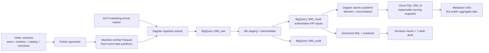
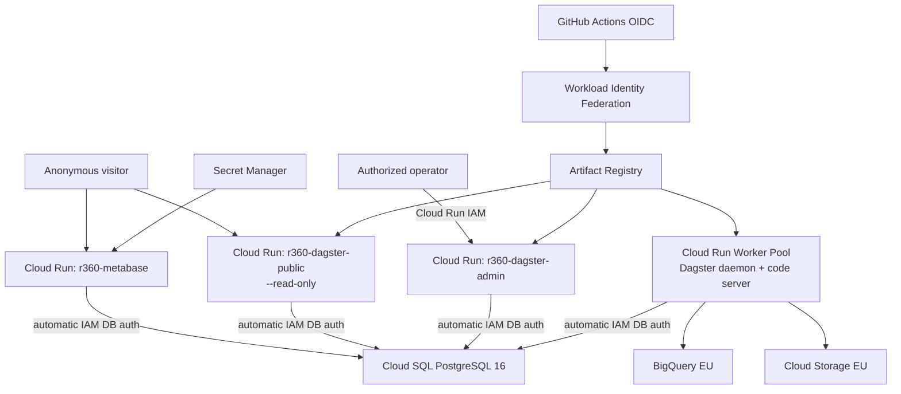

# Architecture and trust boundaries

## End-to-end data flow

## Hosted topology

The demo is incubated in the existing billed TraceGate project under a strict namespace and state
boundary. Terraform owns Rider resources only; the project, TraceGate VM, disk, VPC, and firewall
rules remain outside state. All durable Rider names use `r360-` and all BigQuery datasets use
`r360_`. [`docs/gcp/tracegate_after.md`](gcp/tracegate_after.md) records the preservation evidence.

## Responsibility split

| Component | Owns | Explicitly does not own |
|---|---|---|
| Generator | Coherent fictional behavior, anomalies, hidden truth, manifests | KPI SQL |
| BigQuery raw | Source-faithful rows and ingestion metadata | Silent corrections |
| dbt | Canonical grains, deduplication, time/FX/maturity logic, governed marts | Orchestration |
| Dagster | Dependencies, four-day schedule/sensor lookback, checks, backfills, publication | Competing transformation logic |
| PostgreSQL | Read-optimized copies of approved aggregate marts | Authoritative metrics or raw events |
| Metabase | Display metadata, filters, cards, tabs | Heavy joins, raw identity, BigQuery access |
| Analysis | Diagnostics, adjusted estimates, uncertainty, decisions | Rewriting source-of-truth facts |

## Authentication and data exposure

- Local engineering uses Application Default Credentials; hosted workloads use attached service
  accounts. No service-account JSON key is created.
- Metabase's identity has Cloud SQL connectivity only and no BigQuery IAM role.
- Dagster uses a separate identity for BigQuery, Storage, logging, and database publication.
- Public Metabase cards query approved aggregate tables. Public Dagster runs with the supported
  read-only flag. The admin service is not an anonymous endpoint.
- The generated dataset is synthetic, but the architecture still applies minimization: no names,
  addresses, exact child measurements, free text, or public row-level customer/order views.

## Availability and failure behavior

Publication builds a new PostgreSQL schema, validates every allowed table, and promotes it in one
transaction. An exception rolls the transaction back, leaving the previous `r360_bi` schema
readable. Cloud Run UI services are single-instance portfolio services; screenshots are the planned
fallback during scale-to-zero/startup or provider outages.

Raw date-range backfills use a separate short-lived Rider table per source and transactionally
delete/insert/assert/commit only the requested partitions. The same range can be replayed safely.
The daily schedule and GCS marketing marker request the latest four manifest dates; both are stopped
by default. BigQuery audit tables make freshness, current checks, reconciliation, data-through, and
Rider-only job bytes queryable without exposing Dagster's internal database.
